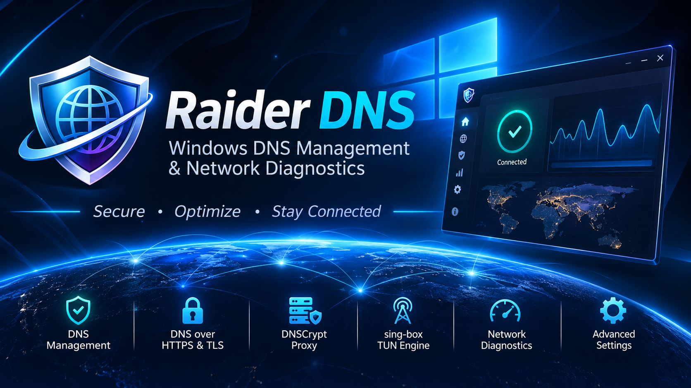
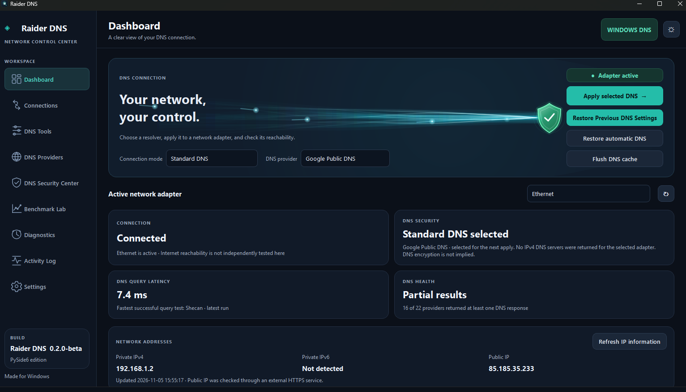
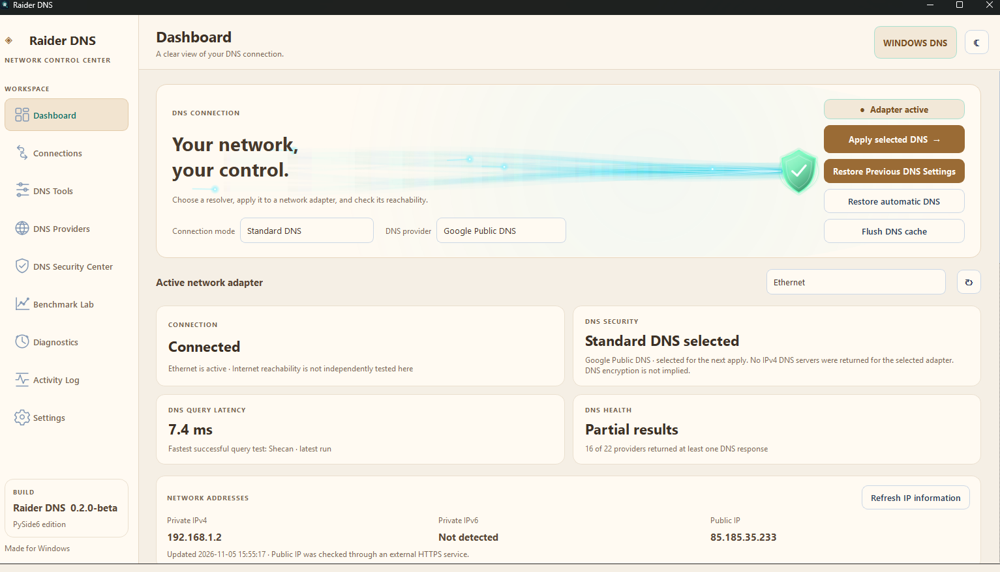

<p align="center">
  
</p>

<h1 align="center">Raider DNS</h1>

<p align="center">
  <strong>Windows DNS Management · Encrypted DNS · Network Diagnostics · Traffic Tunneling</strong>
</p>

<p align="center">
  <a href="https://github.com/shattered-Devil/Raider-DNS/releases"></a>
  
  
  <a href="https://github.com/shattered-Devil/Raider-DNS"></a>
</p>

<p align="center">
  <em>Secure · Optimize · Stay Connected</em>
</p>

---

## Overview

**Raider DNS** is a Windows desktop application for managing system DNS, configuring encrypted DNS transports, measuring resolver performance, diagnosing connectivity, and managing local DNS and traffic-tunneling engines.

Built with **Python and PySide6**, Raider DNS combines Windows DNS configuration workflows with two separately managed engines:

- **DNSCrypt Proxy** for local encrypted DNS resolution and supported DNS filtering/forwarding features.
- **sing-box** for profile-driven TUN routing of device IP traffic.

The application also supports Windows-native DNS-over-HTTPS (DoH), Windows-native DNS-over-TLS (DoT), browser-specific DoH controls for supported browsers, a resolver catalogue, reusable DNS profiles, diagnostics, benchmarking, activity history, and theme/language preferences.

> **Release status:** 0.2 Beta. Raider DNS can make machine-wide network changes. Validate DNS changes, TUN routing, engine shutdown, and installer behavior on a disposable Windows test machine or virtual machine before relying on the application on a primary system. A passing unit-test suite does not replace live Windows network testing.

## Screenshots

> **Screenshot accuracy note:** The two application captures below are genuine Raider DNS screenshots from the earlier **v0.1.7** interface. They are included as historical UI references because updated v0.2 screenshots were not available when this README was prepared. The v0.2 interface has since been reorganized: the standalone Profiles and Network Intelligence pages were removed, the sing-box executable picker was removed, and the Connections/Settings UI was updated. Replace these two images with fresh v0.2 captures before treating them as current UI screenshots.

### Dashboard ( dark theme )

<p align="center">
  
</p>

### Dashboard ( warm paper theme )

<p align="center">
  
</p>

---

## Main capabilities

### 1. Dashboard and network context

The Dashboard is the primary status overview. It brings key network context into one place instead of displaying a separate Network Intelligence page.

- Shows the selected DNS mode and provider context.
- Presents a compact connection status overview.
- Displays the saved automatic-profile match, when applicable, without exposing SSIDs or adapter identifiers in the profile summary.
- Shows the managed DNSCrypt and sing-box engine state.
- Presents DNS health and resolver measurement summaries when fresh results are available.
- Provides access to common DNS apply, restore, and cache actions.
- Includes the **Plasma Stream** visual, with four animated ribbons and eleven fine filaments.

The Dashboard intentionally does **not** show Wi-Fi/adapter hardware inventory or a separate network-recovery panel.

### 2. DNS Connections and transport modes

The Connections page brings DNS transport selection and the managed local engines together.

| Mode | Scope | What it does | Separate engine |
|---|---|---|---|
| Standard DNS | Windows system DNS | Applies ordinary resolver addresses to the selected Windows adapter. | No |
| Windows DoH | Windows system DNS | Uses supported Windows DNS Client encrypted-DNS registration and adapter configuration. | No separate Raider-managed engine |
| Windows DoT | Windows system DNS | Configures supported Windows DNS-over-TLS behavior using resolver identity/hostname information. | No separate Raider-managed engine |
| Browser DoH | Supported browser | Configures the browser's own secure-DNS behavior and supported scope settings. | Browser dependent |
| DNSCrypt Proxy | Local DNS path | Points Windows DNS to the local DNSCrypt Proxy only after the local service/query checks succeed. | `dnscrypt-proxy.exe` |
| sing-box TUN | Device IP traffic | Runs a user-provided sing-box TUN profile to route traffic according to its inbound, outbound, and routing rules. | `sing-box.exe` |

**Important distinction:** DoH, DoT, and DNSCrypt encrypt DNS lookups; they do not automatically tunnel all application traffic. sing-box TUN is a separate traffic-routing feature and only routes traffic as defined by the user's configuration.

### 3. DNS Providers and reusable profiles

The DNS Providers page combines the resolver catalogue with reusable DNS profiles.

- Browse built-in DNS providers.
- Add and manage custom providers.
- Search and organize the provider catalogue.
- Mark providers as favorites and reorder them.
- Create, apply, and delete reusable DNS profiles.
- Import and export supported provider/profile data.
- Keep saved configuration data locally in the application's user data area.

Automatic network-profile matching is separate from ordinary manual profile selection. It is opt-in and uses exact saved SSID and/or adapter matching rather than fuzzy matching. Automatic application is limited to Standard DNS and Windows-native DoH and requires the necessary elevation. Other saved transport profiles can remain available for manual use.

### 4. DNSCrypt Proxy management

Raider DNS manages the official **DNSCrypt Proxy** executable as an external local process; it does not implement a replacement DNSCrypt protocol engine.

Supported management areas include:

- Managed engine start/stop and status reporting.
- Local configuration generation and validation.
- Resolver selection and supported resolver-pool/load-balancing configuration.
- DNS filtering using supported allow/block rules.
- Forwarding rules for supported Split DNS scenarios.
- Optional DNS query logging and a local query monitor.
- Safe handling of configuration changes and service shutdown.

DNSCrypt uses a local loopback listener. Raider DNS checks the local proxy path before leaving Windows adapter DNS pointed at loopback. If an adapter may still depend on the local proxy, the application should not simply remove or stop the engine without resolving that dependency.

**Logging privacy:** DNS query logging is off by default. Query logs can contain domain names, resolver details, timestamps, and local client addresses. Enable it only when needed and review the log before sharing it.

### 5. sing-box TUN traffic tunneling

Raider DNS integrates the official **sing-box** command-line engine as a separately managed process.

- The executable is discovered from the Raider DNS installation's managed engine directory; the UI does not ask users to browse for an arbitrary EXE.
- Users select a compatible sing-box JSON profile.
- The profile is checked with the bundled CLI before the application attempts to start the tunnel.
- The Connections page provides distinct validation, start, and stop actions.
- Engine state is exposed to the Dashboard and Engine Supervisor.
- The tunnel uses the profile's TUN inbound, outbound, DNS, and routing rules.

**What is not included:** Raider DNS does not provide a VPN server, proxy subscription, account, endpoint, or credentials. Users must supply a valid profile and have access to a working remote proxy/server. TUN routing generally requires administrator privileges. A running process alone does not prove that every application's traffic or DNS is routed as intended; test routes and DNS behavior on the target Windows system.

#### sing-box engine staging for maintainers

The source repository intentionally excludes third-party engine binaries. For an installer build, the maintainer stages the complete official Windows CLI distribution under:

```text
engines/
└── sing-box/
    ├── sing-box.exe
    ├── LICENSE
    └── other upstream companion files (when supplied)
```

Keep the full upstream license and companion files. Do not put private proxy profiles, subscriptions, credentials, or private keys in this directory. The installer preparation script stages the engine payload for Inno Setup.

### 6. Engine Supervisor

The Engine Supervisor monitors Raider DNS-managed DNSCrypt Proxy and sing-box process state.

- Detects whether managed processes are running.
- Distinguishes expected user-requested stops from unexpected exits where the controller has sufficient state.
- Reports unexpected process termination to the user.
- Uses bounded polling and local process state.
- Does not automatically restart a failed engine.
- Does not force-kill processes or terminate unrelated processes with the same executable name.
- Does not treat process existence as proof of resolver reachability, proxy health, route integrity, or leak-free traffic.

### 7. DNS Security Center

The DNS Security Center provides a place to inspect DNS security-related configuration and run supported checks.

- Review relevant Windows DNS and encrypted-DNS configuration.
- Inspect supported DoH template registration/configuration state.
- Review DNS health information.
- Run the available DNS audit.
- Run an external DNS leak test when the user chooses to do so.

An external leak test contacts a third-party service. That service may observe the public IP address and recursive resolvers used during the test. The test does not automatically inspect every browser's independent DoH traffic.

### 8. Benchmark Lab

Raider DNS includes resolver measurement tools so provider selection is based on measured behavior rather than assumptions.

Available measurements include:

- Actual DNS query/response latency.
- TCP connection time to port 53.
- ICMP round-trip time where Windows and the network permit it.
- Repeated same-name queries and unique-name query samples in the advanced benchmark workflow.
- Summary statistics and provider ranking from completed measurements.
- Export of supported benchmark results.

ICMP latency, TCP connection time, and DNS query latency measure different things. A low ping does not necessarily mean a resolver returns DNS answers faster. Results are network-, resolver-, and time-dependent; rerun tests when conditions change.

### 9. Diagnostics and safer recovery guidance

Diagnostics helps investigate connectivity and DNS issues through user-initiated checks and selective repairs.

- Connectivity and DNS checks.
- DNS and HTTPS reachability checks where applicable.
- Selected-link/gateway/IP status and relevant connection tests.
- Actionable, non-destructive recovery guidance.
- Supported manual repair operations with explicit user action.

The old standalone Network Recovery and hardware-inventory presentation has been removed. Internal recovery history is local, bounded, and coarse-grained. It is not a hidden mechanism for resetting drivers, deleting routes, changing unrelated VPN settings, or terminating unknown processes.

### 10. Activity Log

The Activity Log provides a local history of application actions and outcomes.

- Records supported DNS operations, diagnostics, repairs, imports, and application actions.
- Supports reviewing and exporting history where available.
- Uses configurable retention limits to prevent unbounded growth.
- Remains local to the user's machine unless the user exports and shares it.

Review exported logs before sharing them; diagnostic details may reveal domain names, addresses, or local network information.

### 11. Settings, themes, and language

Settings groups application preferences and local data-management options.

- Nine themes: Dark, Light, Light Mild, Paper, Warm Sand, Mist Blue, Midnight, Ocean, and High Contrast.
- Theme-aware on/off switches with checked, unchecked, knob, and focus colors derived from the active Raider DNS theme.
- English and Persian language selection under Appearance.
- Persian right-to-left layout support for the application interface.
- Fixed tooltip delay of 750 ms; there is no user-configurable tooltip-delay setting.
- DNS health check interval, timeout, failure, and recovery thresholds.
- Engine Supervisor enablement and polling interval.
- Network-change polling preferences.
- Settings backup/export and restore/import workflows.
- Configurable activity-history retention.

Some operating-system, provider-supplied, and third-party engine messages may remain in their original language even when the application interface is set to Persian.

---

## DNS change safety

Changing system DNS affects the machine's network configuration. Raider DNS retains a transactional approach for supported Windows DNS operations:

1. Identify the selected adapter and validate the requested settings.
2. Capture and persist a recovery snapshot before changing the adapter.
3. Serialize conflicting DNS mutations so overlapping operations do not race.
4. Apply the requested DNS configuration.
5. Read the resulting Windows configuration back and perform applicable validation checks.
6. Keep the recovery information available so the previous configuration can be restored if required.
7. Attempt rollback when a supported operation fails validation or the resulting configuration does not match expectations.

Use **Restore Previous DNS Settings** to restore the saved previous configuration. This is not the same as selecting automatic/DHCP DNS: the previous configuration may have been a manually configured resolver.

Do not assume that a successful Windows configuration command proves internet access or encrypted resolver use. Verify DNS resolution and connectivity after changing modes.

## Feature boundaries and important limitations

| Feature | Does | Does not guarantee |
|---|---|---|
| Standard DNS | Changes the configured resolver addresses. | Encryption or resolver availability. |
| DoH / DoT | Configures supported encrypted DNS behavior. | Encryption for all application traffic. |
| Browser DoH | Changes DNS behavior for supported browsers. | System-wide DNS behavior or control over unsupported browsers. |
| DNSCrypt | Uses a local DNSCrypt Proxy for DNS queries sent to it. | Filtering of browser/app traffic that bypasses system DNS. |
| Split DNS | Forwards matching DNS names according to DNSCrypt rules. | General IP traffic splitting. |
| sing-box TUN | Routes traffic according to the user profile. | A working remote server, universal app coverage, or leak-free operation without validation. |
| Engine Supervisor | Observes managed process state and reports unexpected exits. | Remote endpoint health or automatic repair/restart. |
| Recovery guidance | Presents local, non-destructive advice. | Automatic driver, route, or unrelated VPN repair. |

## Privacy and data handling

- Automatic network matching uses exact local identifiers when needed; identifiers are not displayed in the Dashboard profile summary.
- Internal recovery snapshots are bounded and sanitized to avoid retaining raw adapter names, SSIDs, gateway addresses, and detailed diagnostic payloads.
- DNSCrypt query logging is opt-in and may reveal browsing-related domain history.
- External DNS leak tests contact a third-party endpoint and may expose public network metadata.
- Settings backups and diagnostic exports may contain provider names, DNS addresses, or operational details. Protect them and redact before public sharing.
- Do not publish sing-box profiles, subscription URLs, proxy credentials, private keys, or recovery files in GitHub issues.

## Installation

1. Open the [GitHub Releases](https://github.com/shattered-Devil/Raider-DNS/releases) page.
2. Download the Windows installer for the release you intend to test.
3. Run the installer and review the component selection page.
4. The application is required. The current installer configuration offers DNSCrypt Proxy and sing-box TUN Engine as separate engine components and preselects them; a Custom installation can omit a component if the installer script defines it as selectable.
5. Launch Raider DNS and configure the desired DNS mode or provide a compatible sing-box profile.
6. Installing the engine files does **not** automatically activate DNSCrypt or start a TUN tunnel. Activation remains a user action inside Raider DNS.

### Before uninstalling

- Restore the saved previous Windows DNS settings if DNSCrypt was active.
- Stop DNSCrypt only after confirming no adapter still depends on its loopback listener.
- Gracefully stop any active sing-box TUN tunnel from Raider DNS.
- If tunnel shutdown cannot be confirmed, do not force-kill the engine or manually delete unknown routes/adapters. Keep the application open and inspect Diagnostics/network state.

The uninstaller does not silently rewrite adapter DNS or remove unknown VPN/TUN routes.

## Requirements

### Running the application

- Windows 10/11, x64 target.
- Administrator privileges for operations that modify system DNS or configure TUN routing.
- DNSCrypt Proxy and/or sing-box engine component installed for the corresponding features.
- A valid user-provided sing-box profile and working remote endpoint to use traffic tunneling.

### Running from source

- Python 3.11 or newer (the maintainer's current build environment uses Python 3.14).
- Dependencies listed in `requirements.txt` (PySide6).
- Windows is required for real adapter operations, UAC, and TUN integration.

### Building the Windows installer

- PyInstaller 6.x.
- Inno Setup 6 or newer.
- PowerShell for engine preparation scripts.
- Internet access when the DNSCrypt package is not already cached.
- Complete official sing-box Windows CLI package staged by the maintainer, including its license and companion files.

## Run from source

Open a terminal in the directory containing `main.py`:

```powershell
python -m pip install -r requirements.txt
python .\main.py
```

## Run the test suite

```powershell
python -m compileall -q main.py raider_dns tests
python -m unittest discover -s tests -v
```

The optional Qt render smoke test should be run in an environment with PySide6 installed. Source/unit tests do not prove that Windows DNS mutations, UAC, DoH/DoT, DNSCrypt loopback, sing-box TUN routing, installer operation, or shutdown/recovery are correct on every Windows machine.

## Build a single-file Windows executable with PyInstaller

The following PowerShell command uses absolute source paths. This is intentional: when a `.spec` file is written into a separate directory, relative `--add-data` paths can otherwise resolve relative to the spec directory rather than the project root.

Run PowerShell from the project root (the folder containing `main.py`):

```powershell
$Python = (Get-Command python).Source
$Root = (Get-Location).Path

& $Python -m pip install -r (Join-Path $Root 'requirements.txt')
& $Python -m pip install --upgrade 'PyInstaller>=6.22,<7'
& $Python -m pip check
& $Python -m compileall -q (Join-Path $Root 'main.py') (Join-Path $Root 'raider_dns')

& $Python -m PyInstaller `
    --noconfirm `
    --clean `
    --onefile `
    --windowed `
    --name 'Raider DNS' `
    --icon (Join-Path $Root 'assets\app_icon.ico') `
    --version-file (Join-Path $Root 'installer\version_info.txt') `
    --add-data "$(Join-Path $Root 'assets');assets" `
    --add-data "$(Join-Path $Root 'COPYRIGHT_AND_THIRD_PARTY_NOTICES.txt');licenses" `
    --distpath (Join-Path $Root 'release') `
    --workpath (Join-Path $Root 'build\pyinstaller-onefile') `
    --specpath (Join-Path $Root 'build\spec-onefile') `
    (Join-Path $Root 'main.py')

Copy-Item (Join-Path $Root 'COPYRIGHT_AND_THIRD_PARTY_NOTICES.txt') (Join-Path $Root 'release') -Force
Copy-Item (Join-Path $Root 'LICENSE_STATUS.md') (Join-Path $Root 'release') -Force
Copy-Item (Join-Path $Root 'THIRD_PARTY_NOTICES.md') (Join-Path $Root 'release') -Force
```

Expected application output:

```text
release/
├── Raider DNS.exe
├── COPYRIGHT_AND_THIRD_PARTY_NOTICES.txt
├── LICENSE_STATUS.md
└── THIRD_PARTY_NOTICES.md
```

The PyInstaller executable is the application binary. It does not, by itself, replace the Inno Setup installer that stages the separate DNSCrypt Proxy and sing-box engines.

## Build the Windows installer

1. Stage the complete official sing-box CLI distribution in `engines\sing-box\` and retain its upstream `LICENSE` and companion files.
2. Build `release\Raider DNS.exe` using the instructions above.
3. Run the one-file installer build script from the project root:

```cmd
build_onefile_installer.bat
```

The build script prepares/verifies the pinned DNSCrypt Proxy package, stages the sing-box package, locates Inno Setup, and compiles `installer\RaiderDNS_OneFile.iss`.

Expected output:

```text
release\RaiderDNS_Setup_0.2_beta_x64.exe
```

The exact component-selection behavior is controlled by the `[Components]` and `[Code]` sections in the `.iss` file. Keep the application required; the current maintainer configuration selects the DNSCrypt and sing-box components by default. If you want them to be optional, do not mark those component entries with `Flags: fixed`.

## Copyright and third-party licensing

**Application copyright:**

`Copyright © 2026 Nima Zahedi GitHub: Shattered-Devil`

The application-level license has not been selected in this source package. Copyright ownership does not automatically grant the public permission to copy, modify, redistribute, or publish derivative versions. Do not describe Raider DNS as open source until an explicit application license is added.

Raider DNS uses or distributes third-party components with their own licenses and notices, including PySide6/Qt, DNSCrypt Proxy, sing-box, and PyInstaller. Their licenses are separate from the Raider DNS application copyright. Review and include the applicable upstream license texts and redistribution materials before publishing a packaged build. sing-box is GPL-3.0-or-later with an additional upstream term; preserve its complete upstream license and notices and review the additional term before distribution.

See:

- [`LICENSE_STATUS.md`](LICENSE_STATUS.md)
- [`THIRD_PARTY_NOTICES.md`](THIRD_PARTY_NOTICES.md)
- [`COPYRIGHT_AND_THIRD_PARTY_NOTICES.txt`](COPYRIGHT_AND_THIRD_PARTY_NOTICES.txt)
- [sing-box upstream repository](https://github.com/SagerNet/sing-box)
- [DNSCrypt Proxy upstream repository](https://github.com/DNSCrypt/dnscrypt-proxy)
- [Qt for Python licensing](https://doc.qt.io/qtforpython-6/commercial/index.html)
- [PyInstaller licensing](https://pyinstaller.org/en/stable/license.html)

## Security reporting

Please do not publish exploit details, private DNS profiles, subscription URLs, credentials, private keys, adapter dumps, or unredacted recovery files in public issues.

Use the repository's [Security Advisories](https://github.com/shattered-Devil/Raider-DNS/security/advisories) feature when enabled. Otherwise, contact the maintainer privately through the GitHub profile and request a secure channel.

For ordinary bugs and feature requests, use [GitHub Issues](https://github.com/shattered-Devil/Raider-DNS/issues). Include the application version, Windows edition/build, reproduction steps, and relevant logs after removing private network information.

## Project files

- [`CHANGELOG.md`](CHANGELOG.md) — project change history.
- [`RELEASE_NOTES.md`](RELEASE_NOTES.md) — release-specific summary.
- [`TEST_REPORT.md`](TEST_REPORT.md) — automated test coverage and known validation gaps.
- [`SECURITY.md`](SECURITY.md) — security reporting and safe testing.
- [`CONTRIBUTING.md`](CONTRIBUTING.md) — contribution guidance.

## Maintainer

**Nima Zahedi**  
GitHub: [Shattered-Devil](https://github.com/shattered-Devil)  
Repository: [Raider-DNS](https://github.com/shattered-Devil/Raider-DNS)

---

<p align="center">
  <strong>Raider DNS</strong><br />
  Secure · Optimize · Stay Connected<br />
  <sub>Copyright © 2026 Nima Zahedi GitHub: Shattered-Devil</sub>
</p>
