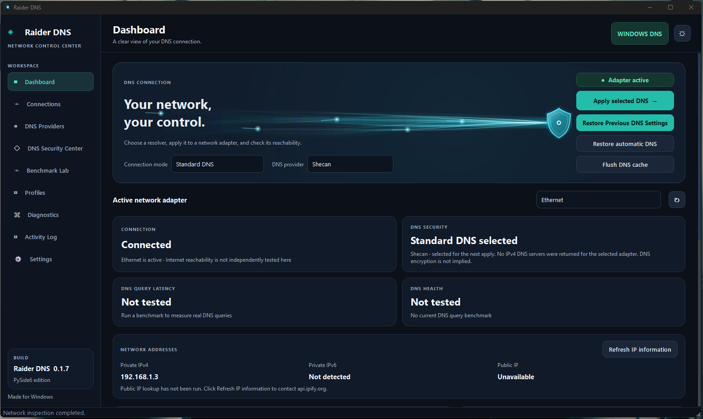
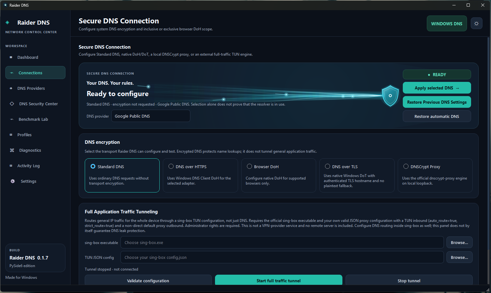

<div align="center">
  

  # Raider DNS

  **Windows DNS Management & Network Diagnostics**

  [](https://www.microsoft.com/windows)
  [](https://www.python.org/)
  [](https://doc.qt.io/qtforpython-6/)
  [](https://github.com/shattered-Devil/Raider-DNS/releases)

  [Download](https://github.com/shattered-Devil/Raider-DNS/releases) ·
  [Features](#features) ·
  [Security](#security--network-safety) ·
  [Documentation](docs/) ·
  [Issues](https://github.com/shattered-Devil/Raider-DNS/issues)
</div>

---
## Application Screenshots

### Dashboard


### Connections

## About

**Raider DNS** is a Windows desktop application for managing DNS configuration, encrypted DNS transports, resolver performance, network diagnostics, and DNS recovery. It is built with Python and PySide6 / Qt Widgets.

> **Current version:** `0.1.7` — Release Candidate  
> **Maintainer / copyright:** Nima Zahedi · Copyright (C) 2026 Nima Zahedi  
> **Target:** Windows 10/11 x64. Windows 11 is the recommended target.

This repository follows the same public-release approach as the maintainer's Noble Password Manager project: the root README is the project landing page, `Source Code/` contains the application source, and `docs/` contains release and technical documentation.

# Raider DNS v0.2 beta

**Windows DNS management, encrypted DNS controls, resolver diagnostics and managed-engine supervision.**

Raider DNS is a Windows desktop application built with Python and PySide6. It manages Windows adapter DNS settings, supports Windows-native DoH/DoT and the official DNSCrypt Proxy engine, provides resolver measurements, DNSCrypt filtering and split DNS, and includes installer-managed DNSCrypt Proxy and sing-box TUN engines for encrypted DNS and full-device IP traffic routing. Both engines are required installer components but are started only when the user activates them.

> **Release status:** v0.2 beta is an editable source release candidate. Automated source tests and ZIP integrity are checked in this environment. Actual Windows adapter changes, DNSCrypt/sing-box runtime behavior, UAC, installer execution, GUI rendering, Persian RTL layout, CPU/RAM use and live shutdown/recovery still require validation on supported Windows hardware.

## What's new in v0.2 beta

- **Dashboard network context:** the former Network Intelligence page is removed. The Dashboard now presents a compact connection overview, selected DNS mode/provider, saved network-profile match and managed-engine state, inspired by the at-a-glance connection status used by VPN clients. It excludes adapter/Wi-Fi hardware inventory and any separate recovery panel; the obsolete hardware-inventory collector is removed from the source tree.
- **Unified DNS Providers page:** reusable DNS profiles are embedded alongside the resolver catalogue. Create, apply, delete, import and export operations remain available; saved profile data is still local.
- **Modern settings switches:** applicable preference checkboxes use theme-aware on/off controls. The tooltip delay is fixed at **750 ms** and is no longer configurable.
- **Persian interface option:** English and Persian are selectable under Settings → Appearance. Persian mode enables right-to-left layout. Provider names, IP addresses, hostnames and user-entered data remain unchanged. Some third-party/runtime messages may remain in English.
- **Navigation refresh:** each tab has its own larger SVG icon; the side navigation retains the nine primary pages.
- **Engine Supervisor:** periodically observes the Raider DNS-managed DNSCrypt Proxy and sing-box process state. Unexpected exits are surfaced as failures; intentional stops are distinguished. It does not auto-restart processes, force-kill engines, rewrite routes or infer upstream health from process existence.
- **Safer internal network recovery:** bounded, local recovery history is advisory only and is no longer presented as a separate page. Legacy history is sanitized on read; snapshots discard adapter names, SSIDs, gateway addresses and raw diagnostic details. Recovery recommendations remain non-destructive.
- **Settings expansion:** engine-supervisor enablement and polling interval, network-change polling, DNS health thresholds, backup/import actions, and configurable activity-history retention (100–5,000 entries) are grouped in Settings.
- **DNS safety retained:** serialized adapter changes, durable snapshots, Windows read-back and rollback paths remain in place. DNSCrypt still requires a successful local DNS query before Windows DNS is left pointing to loopback.
- **Plasma Stream:** visual density remains **4 ribbons and 11 filaments**.
- **Copyright:** `Copyright © 2026 Nima Zahedi GitHub: Shattered-Devil`.

## Main capabilities

- Standard DNS configuration for Windows network adapters.
- Windows-native DNS-over-HTTPS and DNS-over-TLS registration and verification.
- DNSCrypt Proxy engine with managed local configuration (installed by the required engine component; activation remains user-controlled).
- Browser-native DoH controls for supported browsers.
- Installer-managed sing-box TUN engine. The engine is discovered automatically from `engines/sing-box/sing-box.exe`; users only select their JSON profile. The engine is required by the installer but is not started automatically.
- DNS resolver catalogue, custom providers, favourites, ordering, reusable profiles and import/export.
- Resolver benchmarking with DNS-query, TCP/53 and ICMP measurements.
- DNSCrypt query monitoring, filtering, allowed/blocked rules and split DNS forwarding.
- Connectivity diagnostics, selective repairs, activity logging and CSV export.
- Transactional DNS changes with durable snapshots, Windows read-back and rollback on configuration mismatch.
- Exact-match automatic network profiles (opt-in) and resolver failover for supported DNS modes.
- Managed-engine process supervision with bounded polling and no automatic process termination.

## Feature boundaries and operational notes

- **Automatic network profiles:** exact saved SSID and/or adapter matching only. Automatic application is off by default, applies only to Standard DNS and Windows-native DoH, and requires elevation for Windows DNS changes. Saved DoT and DNSCrypt profiles remain manual.
- **Engine Supervisor:** process activity is not equivalent to resolver or tunnel health. DNSCrypt query success and sing-box route integrity are validated by their own workflows. Supervisor alerts do not restart an engine.
- **Recovery history:** hidden from the navigation and dashboard; it stores only coarse link/diagnostic state locally. It never resets adapters, drivers, routes or proxy settings.
- **Automatic resolver failover:** configured primary/fallback pair for Standard DNS and Windows-native DoH. It waits for repeated health failures and confirms fallback response before switching. DNSCrypt uses its own upstream resolver pool/load-balancing.
- **Split DNS and local filtering:** DNSCrypt Proxy features and effective only for traffic sent through the local DNSCrypt proxy. Browser DoH may bypass system DNS.
- **DNS Query Monitor:** requires DNSCrypt query logging and a restart after main TOML changes. Query logs can reveal browsing-related domains; logging is off by default.
- **sing-box:** bundled third-party CLI engine for full-device TUN routing. It is a required installer component but remains inactive until the user starts it. Raider DNS discovers it from its own installation directory; it does not search PATH or arbitrary folders. Users must supply a compatible JSON profile and a working remote proxy endpoint. Graceful shutdown is preferred; unknown adapters and routes are never automatically deleted.

## Privacy

- Automatic network matching reads only the current connected SSID when needed for exact local matching. SSID and adapter identifiers are not shown in the Dashboard profile list.
- Internal network recovery snapshots are bounded to 30 and contain coarse state only; legacy identifiers/raw details are sanitized when loaded.
- DNSCrypt query logging is opt-in and can include domain names, resolver information and client addresses.
- External DNS leak tests contact a third-party service and may expose the public IP and recursive resolvers used.
- Review and redact diagnostic exports before sharing them publicly.

## Requirements

- Windows 10/11 x64 for system DNS operations; Windows 11 is the recommended target.
- Python 3.11 or newer for running/building from source.
- PySide6 from `requirements.txt`.
- Inno Setup 6 or newer for installer creation.
- Internet access during installer creation to download the hash-pinned DNSCrypt Proxy archive unless the verified archive is cached.

The source ZIP intentionally excludes compiled third-party engine binaries. The Windows installer build downloads and verifies DNSCrypt Proxy. The maintainer stages the official sing-box Windows CLI distribution in `engines/sing-box/`. Both engines are required installer components and cannot be deselected in this v0.2 beta build; neither engine is automatically started by installation. The complete upstream sing-box license and all companion files must remain beside the binary.

## Run from source

```powershell
python -m pip install -r requirements.txt
python .\main.py
```

## Run tests

```powershell
python -m compileall -q main.py raider_dns tests
python -m unittest discover -s tests -v
```

## Build a Windows one-file executable

For your Windows Python 3.14 installation, open PowerShell in the project root and run:

```powershell
$Python = "$env:LOCALAPPDATA\Python\pythoncore-3.14-64\python.exe"

& $Python -m pip install -r requirements.txt
& $Python -m pip install --upgrade "PyInstaller>=6.22,<7"
& $Python -m pip check
& $Python -m compileall -q main.py raider_dns

& $Python -m PyInstaller `
    --noconfirm `
    --clean `
    --onefile `
    --windowed `
    --name "Raider DNS" `
    --icon "assets\app_icon.ico" `
    --version-file "installer\version_info.txt" `
    --add-data "assets;assets" `
    --add-data "COPYRIGHT_AND_THIRD_PARTY_NOTICES.txt;licenses" `
    --distpath "release" `
    --workpath "build\pyinstaller-onefile" `
    --specpath "build\spec-onefile" `
    main.py

Copy-Item "COPYRIGHT_AND_THIRD_PARTY_NOTICES.txt" "release\" -Force
Copy-Item "LICENSE_STATUS.md" "release\" -Force
Copy-Item "THIRD_PARTY_NOTICES.md" "release\" -Force
```

This produces `release\Raider DNS.exe`. The version resource embeds the full application copyright: `Copyright © 2026 Nima Zahedi GitHub: Shattered-Devil`. Keep all three accompanying notice files beside the EXE when distributing it. You can alternatively run `build_onefile_exe.bat`, which also executes the automated test suite before packaging.

**Important:** this PyInstaller EXE is the Raider DNS application, not the complete engine installer. DNSCrypt Proxy and sing-box remain separate managed executables. To distribute the full installable product with both required engines, place the complete sing-box CLI package in `engines\sing-box\` and run `build_onefile_installer.bat`. The script downloads and verifies DNSCrypt Proxy, stages sing-box and builds `release\RaiderDNS_Setup_0.2_beta_x64.exe`. The alternative `build_installer.bat` produces an onedir-based installer.

## Repository and release files

See `CHANGELOG.md`, `RELEASE_NOTES.md`, `TEST_REPORT.md`, `SECURITY.md`, `LICENSE_STATUS.md`, `CONTRIBUTING.md` and the third-party notices before publishing.


## Bundled sing-box engine (v0.2 beta)

Place the complete extracted official sing-box Windows CLI package in `engines\sing-box\`. The required executable is `engines\sing-box\sing-box.exe`; keep all adjacent DLLs and the upstream `LICENSE` file in the same folder. Do not put user profiles, subscription files or credentials there. `build_onefile_installer.bat` stages this folder into the required **sing-box TUN Engine** installer component. The app automatically discovers the installed engine at `<app>\engines\sing-box\sing-box.exe`; there is no executable-path picker.

The TUN profile remains user-provided. The default profile folder is `%APPDATA%\RaiderDNS\sing-box\`. Use a profile compatible with the exact bundled sing-box version. Validation runs the bundled CLI's `check` command before start and rejects a profile that explicitly sets TUN `dns_mode` to `disabled`. On sing-box 1.14+, `hijack` is the default TUN DNS mode when `auto_route` is enabled; the profile must still define a working DNS resolver and routing. A running process does not by itself prove that routes, DNS, or every application's traffic are using the proxy.

sing-box is GPL-3.0-or-later with an additional upstream term. Preserve the upstream license and notices and review its redistribution and naming requirements before publishing an installer. Raider DNS is independent and is not endorsed by the upstream project.
